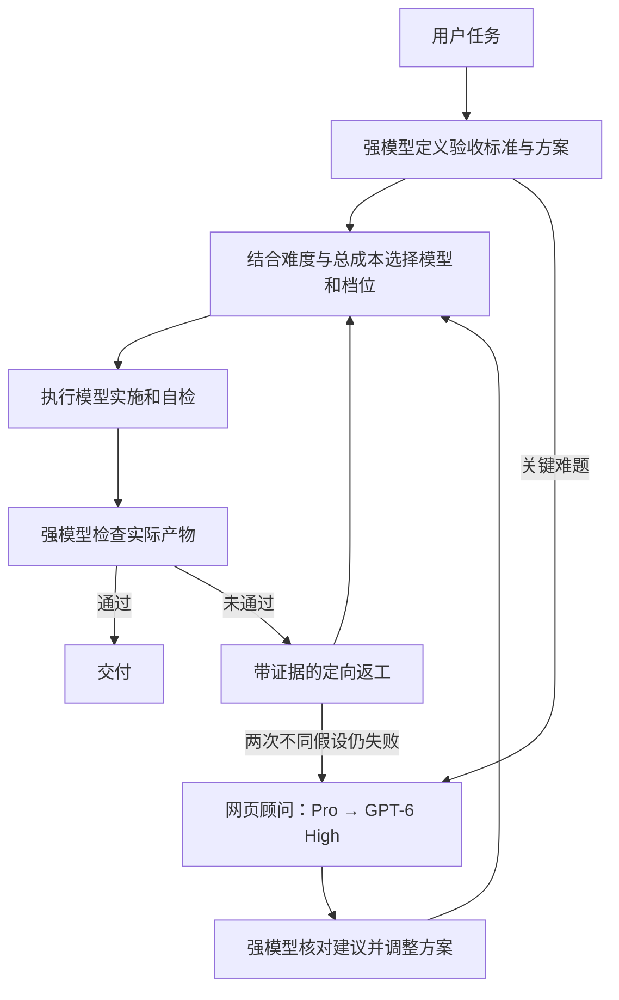

# Token Saver

**强模型规划与验收，按任务选择执行模型，兼顾质量、性价比和完成速度。**

Token Saver 是一个 Codex skill，由强主模型理解需求、制定方案、选择执行模型并最终验收。每个子任务都按难度、失败代价和预计返工量选择合适的模型与思考档位，复杂执行可以直接使用强模型。

优化目标是成功交付的整体成本与耗时，包括模型调用、交接、等待、返工和验收。便宜模型反复失败可能更贵；强模型一次完成也可能更高效。实际 token 消耗与费用取决于任务、模型和运行环境，尚无节省比例的基准测试。

## 工作方式

| 角色 | 默认选择 | 职责 |
| --- | --- | --- |
| 主模型 | 当前 Codex 强模型 | 拆解需求、制定方案、动态选型、最终验收 |
| 执行者 | 按子任务从当前可用模型中选择，思考档位单独决定 | 实施、自检、按反馈修正 |
| 网页顾问 | ChatGPT Pro；不可用时 GPT-6 High | 分析关键难题，提出可验证建议 |

所有模型均以当前环境真实可用的选项为准。Skill 不会自动切换当前聊天的主模型，使用前请自行选好希望负责规划与验收的强模型。



执行者完成后只进入“待验收”。主模型需要核对实际产物，运行关键检查或查看最终界面；未通过就返工，必要标准满足后才宣布完成。

## 如何选择执行模型

| 子任务 | 选择倾向 |
| --- | --- |
| 规则明确的转换、已定位的局部修改 | 快速模型，较低或适中的思考档位 |
| 常规功能、跨文件修改、需要理解现有逻辑 | 能力与速度均衡的模型，按推理需求调整档位 |
| 高耦合重构、复杂算法、并发问题、失败代价高 | 可以直接使用强模型及适当的较高思考档位 |

这是一组判断原则，具体型号由主模型根据当前可用能力选择。无需先从最便宜的模型试起，也无需所有子任务使用同一个模型。执行模型可以与主模型相同。

派发时会简短说明所选模型、档位和理由。任务变难或能力不足时可立即升级；机械收尾可以降档，但会计入重新交接的成本。环境或权限问题先解决阻碍，不靠换模型重试。更换执行者时先停止原执行者对同一范围的写入，再交接当前成果。

## 安装

将仓库放入本地 Codex 的个人 skills 目录。下面使用本项目开发环境采用的目录：

```bash
mkdir -p "${CODEX_HOME:-$HOME/.codex}/skills"
git clone https://github.com/umuworld/token-saver.git \
  "${CODEX_HOME:-$HOME/.codex}/skills/token-saver"
```

如果目标目录已经存在，请先检查现有内容，避免覆盖个人修改。也可以下载仓库 ZIP，将包含 `SKILL.md` 的文件夹命名为 `token-saver`，放到当前客户端配置的 skills 目录中。

安装后在技能列表中查找 **Token Saver**。若未出现，重新打开聊天或重启客户端，再检查安装路径。

## 使用

在请求中使用 `$token-saver`：

```text
使用 $token-saver 修复这个项目的 CSV 导入问题。
保留现有数据格式，先定义验收标准，再根据执行难度选择模型，最后由强模型验收。
```

```text
使用 $token-saver 完成这个功能。
优先考虑完成速度和减少返工，复杂部分可以直接用强模型执行。
遇到关键方案难题时，通过内置浏览器咨询 Pro；没有 Pro 就用 GPT-6 High。
```

适合边界可拆分的开发、修复和多步骤交付。单句问答或很小的机械修改可以直接完成，避免协调成本超过任务本身；明确要求演示分工时仍会按分工执行。

## 运行条件

- **动态模型分工**：需要原生子代理工具支持指定模型与思考档位。自主选择的模型不可用时可重新选型并说明；用户明确指定的模型不可用时会报告限制。
- **网页会诊**：需要可操作 Codex 内置浏览器的工具，以及已登录、可用的 ChatGPT 模式。优先 Pro，备选 GPT-6 High；两者均不可用时会说明原因。
- **主模型验收**：需要访问任务产物及必要验证环境。无法验证的部分会标记为“未验证”。

Skill 本身提供工作指令，浏览器和子代理能力由运行它的客户端提供。它不会创建这些权限，也不会把网页登录态转换为 API 凭据。

## 会诊与恢复规则

- 仅在用户要求、关键取舍无法确定，或同一问题两次有证据的修复仍失败时调用网页顾问。
- 每个难题默认一次会诊，必要时根据新证据追问一次。
- 发送必要的脱敏问题包，不默认上传整个仓库、日志或文件。
- 网页建议须由主模型核对，再交给执行者实施，最后由主模型验收。
- 多轮任务可将进度写入项目允许的 `work/token-saver/<任务标识>/state.md`，恢复时先检查现有状态，避免重复派活和重复发送。

## 文件结构

```text
token-saver/
├── SKILL.md                  # 动态选型、任务交接、返工与验收规则
├── agents/
│   └── openai.yaml           # 技能名称、简介与默认调用提示
├── references/
│   └── web-consult.md        # 网页模型选择、提问与中断恢复
└── README.md
```

## 验证状态

已通过 skill 结构校验，并核对元数据、内部引用与安装副本一致性。动态模型选择、网页会诊和完整协作流程尚未完成端到端测试，暂无 token、费用或耗时改善的基准。

模型选项、网页界面和工具参数可能随客户端变化；运行时以当前工具说明及实际页面为准。
